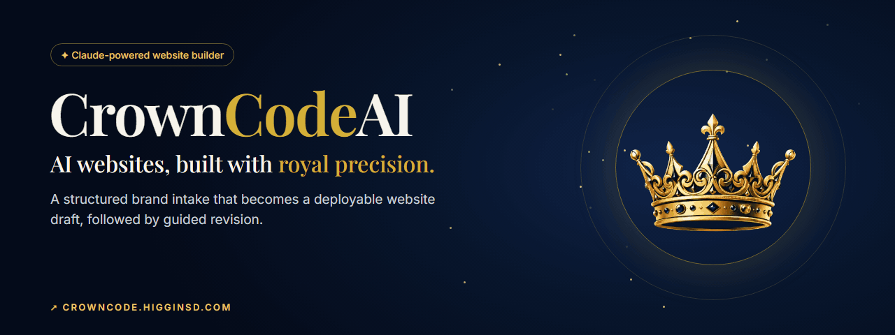
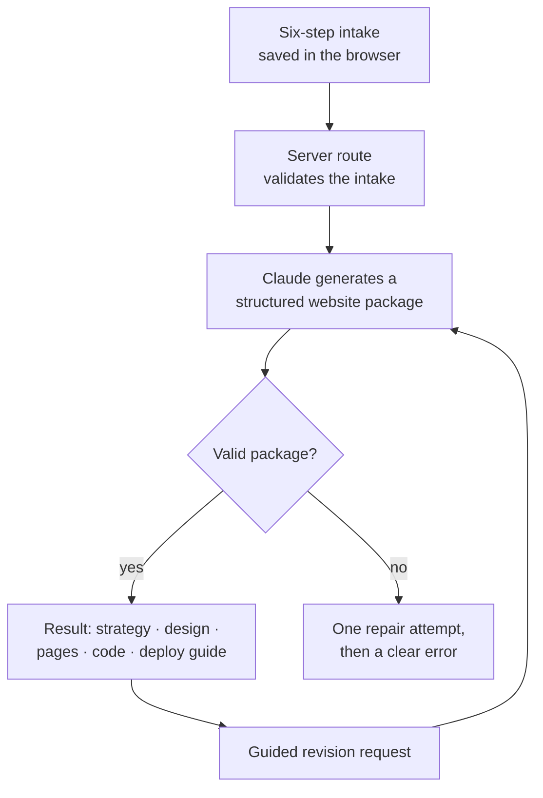

  

<h1 align="center">CrownCode AI</h1>

  <strong>A Claude-powered website builder that turns a structured brand intake into a deployable website draft, then guides the revision.</strong> 
  <a href="https://crowncode.higginsd.com"><strong>Try the builder ↗</strong></a> · <a href="https://www.higginsd.com/work/crowncode-ai">Case study</a> · <a href="https://davishiggins.com">Davis Higgins</a>

Live MVP · In-house product of Higgins Digital · Designed and built by Davis Higgins

---

## See it in motion

  

Real capture of the live builder with a fictional sample business. Intake answers stay in the browser. The recording stops before generation. <a href="assets/demo.png">Static frame</a>

## What it does

- **A structured intake, not a blank prompt box.** Six steps (business basics, brand direction, site structure, content, build preferences, and a final review) capture what a first draft actually needs.
- **A complete website package.** Each generation returns a brand summary, site strategy, sitemap, design system, page-by-page copy, a file tree, starter code, a README, and a plain-English GitHub and Vercel deployment guide.
- **Guided revision.** A second workflow takes the generated package plus a structured change request and returns an updated package, so a revision refines the draft instead of starting over.

## Why I built it

The opening days of a website project repeat the same task every time: turning a rough brand idea into a first structured draft. It's necessary work, but it's the least valuable part of a build, because it happens before anyone has anything concrete to react to.

CrownCode shortens that beginning. It produces a polished first draft with clean code, and a person then directs and refines it. It doesn't replace the judgment in the middle of a project.

## What I built

- Product design, the six-step intake, and the result and revision interfaces
- The prompt system and the server routes that call Claude to generate and revise
- A typed website-package format with validation and a JSON repair pass
- Six starter template families: agency, local business, personal brand, portfolio, SaaS landing, and service business
- CrownCode's own black-navy-and-gold identity, deliberately separate from the studio's

## How it works

### Engineering decisions

| Decision | Why |
|---|---|
| **Structure in, structure out** | The intake is a typed form, and the output is a typed package checked against its shape before it's shown. Every result has the same sections, so the interface can render it reliably and a revision can target one part. |
| **The model never runs in the browser** | Generation and revision happen in server routes that validate input first. The API key stays on the server, and a missing key returns a clear service error rather than a broken page. |
| **Recover once, then fail clearly** | If the model returns malformed JSON, the server makes one repair attempt before giving up with a plain error. A user never sees half a package. |

Intake progress is saved locally in the browser, so a refresh doesn't lose answers and nothing is stored on a server.

## Screens

<table>
  <tr>
    <td width="62%"></td>
    <td rowspan="2" width="38%" align="center"></td>
  </tr>
  <tr>
    <td></td>
  </tr>
</table>

Homepage · Intake step 1 of 6 · Homepage on mobile

## Technology

| Layer | Technology | Responsibility |
|---|---|---|
| App | Next.js 14 (App Router), TypeScript, Tailwind CSS | Landing page, intake, result, revision |
| AI | Anthropic Claude API (server-side) | Package generation and revision |
| Motion | Framer Motion | Interface transitions |
| Hosting | Vercel | Deployment |

## Status and limits

- **An MVP by design.** There are no accounts, saved projects, or payments yet, and deployment is a manual GitHub and Vercel step that the package explains.
- **Drafts, not audited software.** Generated code is a starting point for a developer to review, test, and refine. It isn't production-certified output.
- **Prompts stay private.** The prompt templates and generation logic aren't published.

## About this repository

This is a documentation-only showcase. CrownCode's source, prompts, and configuration aren't included here.

**[Try the builder ↗](https://crowncode.higginsd.com)** · Built by [Davis Higgins](https://davishiggins.com) for [Higgins Digital](https://www.higginsd.com) · [More of my work](https://github.com/DavisHiggins)

© 2026 Davis Higgins. Text and images in this repository are shared for portfolio viewing. CrownCode AI and its crown mark belong to Higgins Digital. Claude is a trademark of Anthropic; CrownCode is not affiliated with Anthropic.
