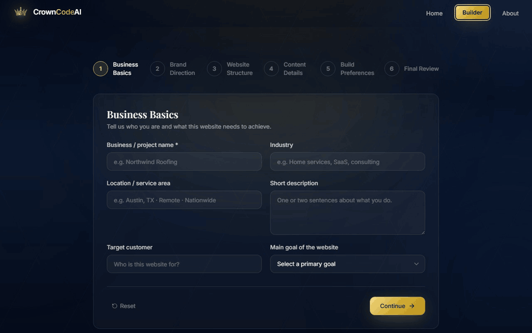
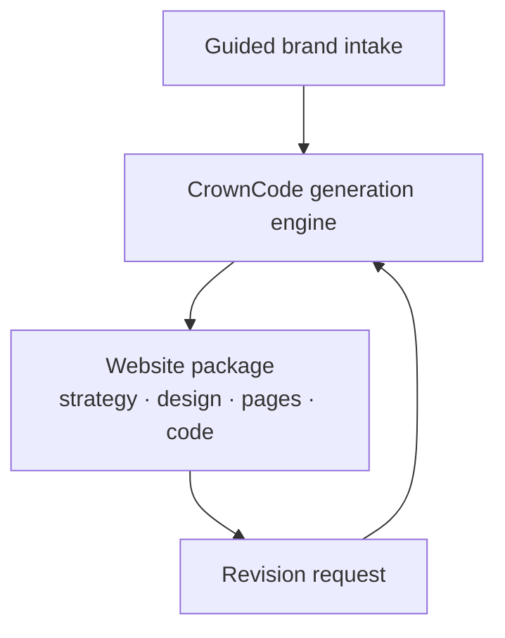
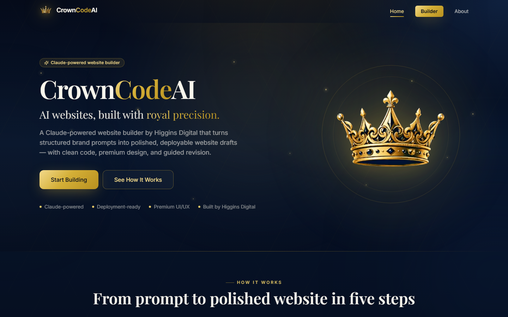
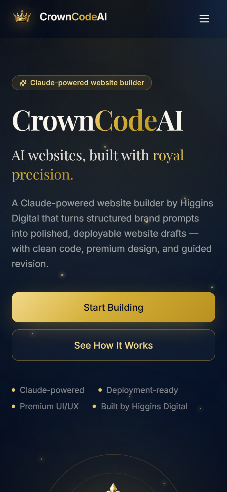
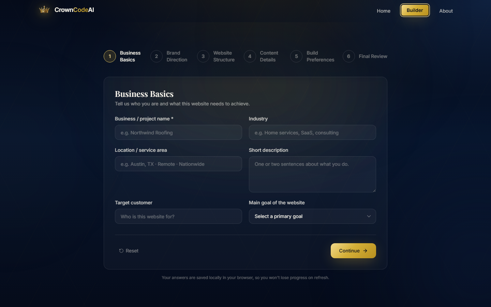

  

<h1 align="center">CrownCode AI</h1>

<strong>An AI website builder that turns a guided brand intake into a polished, deployable website draft, then refines it with you.</strong>

  &nbsp;
  &nbsp;
  

Live · A Higgins Digital product · Designed and built by Davis Higgins

---

## See it in motion

  

Real capture of the live builder with a fictional sample business. <a href="assets/demo.png">Static frame</a>

## What it does

- **A guided intake, not a blank prompt box.** A step-by-step flow captures the business, the brand direction, the site structure, and the content a strong first draft needs.
- **A complete website package.** Each build delivers the strategy, sitemap, design system, page-by-page copy, starter code, and a plain-English guide to taking the site live.
- **Revisions that refine.** Ask for changes and CrownCode updates the existing draft instead of starting over.

## Why I built it

The opening days of a website project repeat the same work every time: turning a rough brand idea into a first structured draft. It's necessary, but it's the least valuable part of a build, because it happens before anyone has anything concrete to react to.

CrownCode shortens that beginning. It produces a polished first draft fast, and a person directs and refines it from there.

## What I built

- Product design, the guided intake, and the result and revision experiences
- The generation and revision engine behind every website package
- Starter designs for the most common kinds of business websites
- CrownCode's own navy-and-gold identity, deliberately distinct from the studio's

<strong>How it's put together</strong>

 

| Decision | Why |
|---|---|
| **Structure in, structure out** | Every build follows the same shape, so the interface can present it cleanly and a revision can target exactly the part that needs to change. |
| **Generation stays on the server** | The engine never runs in the browser, and every request is validated before work begins. |
| **Fail clearly, never halfway** | If a build can't be completed, the user gets a clear message instead of a half-finished package. |

## Screens

<table>
  <tr>
    <td width="62%"></td>
    <td rowspan="2" width="38%" align="center"></td>
  </tr>
  <tr>
    <td></td>
  </tr>
</table>

Homepage · Intake, step one · Homepage on mobile

## Technology

| Layer | Technology |
|---|---|
| App | Next.js, TypeScript, Tailwind CSS |
| Motion | Framer Motion |
| Hosting | Vercel |

---

  &nbsp;
  

© 2026 Davis Higgins. All rights reserved. CrownCode AI and its crown mark belong to Higgins Digital.

